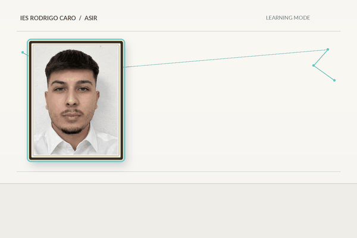

<div align="center">
  

  # ¡Hola! Soy estudiante de ASIR 👋

  **Aprendiendo cómo funciona la tecnología, desde los servidores hasta la red.**

  📍 Coria del Río, Sevilla · 🎓 IES Rodrigo Caro
</div>

---

### `$ whoami`

Soy estudiante del **Ciclo Formativo de Grado Superior en Administración de Sistemas Informáticos en Red (ASIR)** en el **IES Rodrigo Caro**, en Coria del Río.

Me interesa descubrir qué hay detrás de los sistemas y servicios que usamos cada día: cómo se configuran, cómo se conectan y cómo mantenerlos funcionando. Estoy aquí para aprender, practicar y compartir mi progreso, un proyecto a la vez.

### `$ cat areas_de_interes.txt`

```text
> Administración de sistemas y servidores
> Redes y conectividad
> Linux y software libre
> Virtualización y servicios en red
> Automatización y scripting
> Seguridad informática responsable
```

### `$ git status`

```text
Estado: en constante aprendizaje
Objetivo: convertir la curiosidad en experiencia práctica
Próximo paso: seguir construyendo y documentando proyectos
```

### Un poco sobre mi forma de aprender

- 🧪 **Práctica:** probar, configurar y entender el porqué.
- 📝 **Documentación:** dejar cada proceso más claro que como lo encontré.
- 🌱 **Progreso:** cada error es una pista para aprender algo nuevo.

<div align="center">

  **Bienvenido/a a mi espacio. ¡Gracias por pasarte!** 🚀

</div>
